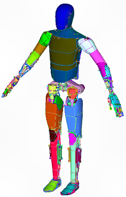
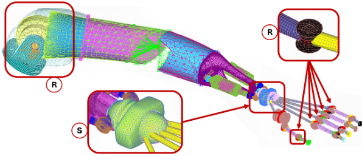
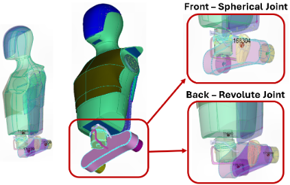
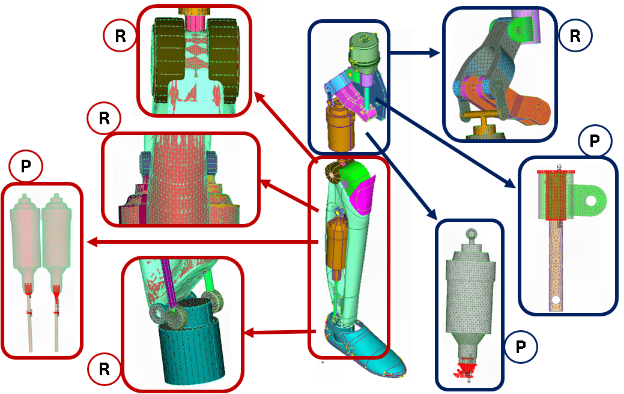

## Overview

One paragraph: what it is, who it is for, and what changed as a result.

## Problem

What was missing or broken, and why it mattered.

## Approach

The design and the one or two decisions that shaped it. Note what you rejected.

**Material Properties**

| MATERIAL | PROPERTY | VALUE | UNIT |
| --- | --- | --- | --- |
| Aluminum | Young's Modulus (E) | 70 | GPa |
| | Poisson's ratio () | 0.3 | - |
| | Density | 2700 | Kg/m³ |

**Elements**

| ELEMENTS | |
| --- | --- |
| Solid | - |
| Plate | Thickness: 0.01 |
| Spring/Damper (CBUSH) | Stiffness: 1x10⁹ N/m |
| | Motion value: 1000 N/m |

## Results

Measurable outcome — latency, accuracy, users, hours saved — plus a link to the
repository or demo.

## Links

- Repository:
- Demo:

## Notes

What you would do differently next time.
