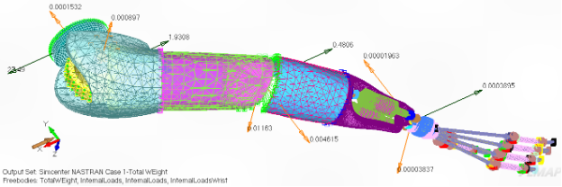
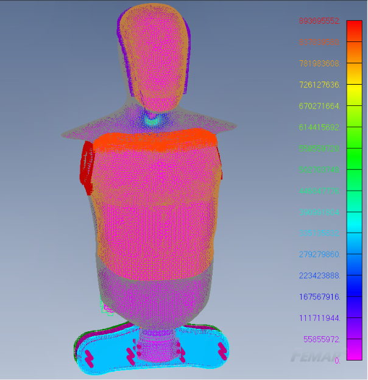
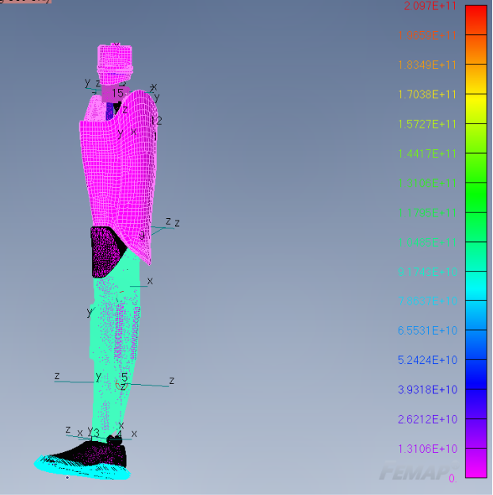

## Overview

One paragraph: what it is, who it is for, and what changed as a result.

## Problem

What was missing or broken, and why it mattered.

## Approach

The design and the one or two decisions that shaped it. Note what you rejected.

**Material Properties**

| MATERIAL | PROPERTY | VALUE | UNIT |
| --- | --- | --- | --- |
| Aluminum | Young's Modulus (E) | 70 | GPa |
| | Poisson's ratio () | 0.3 | - |
| | Density | 2700 | Kg/m³ |

**Elements**

| ELEMENTS | |
| --- | --- |
| Solid | - |
| Plate | Thickness: 0.01 |
| Spring/Damper (CBUSH) | Stiffness: 1x10⁹ N/m |
| | Motion value: 1000 N/m |

In the arm subsystem, a revolute joint is used to represent the shoulder (1) and the joint between the phalanges (3). The wrist was modeled using a solid part with two half spheres that have a spherical joint (2) to simulate the rotation of the wrist.

The leg subsystem consists of a combination of revolute joints to capture the rotation between the knee lower leg and ankle, consisting of 2 revolute joints, 2 revolute joints to capture rotation in the knee area, and another 4 revolute joints capture the motion being transferred from the torso to the quad. At the quad, one prismatic joint is used to take on the translational motion from the torso, then another one at the knee, and finally, prismatic joints to funnel the translational motion to our support. 

## Results

Internal loads transmitted to each joint

