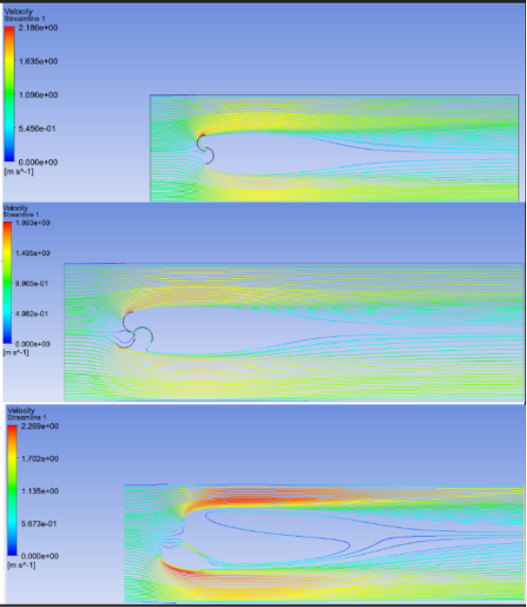
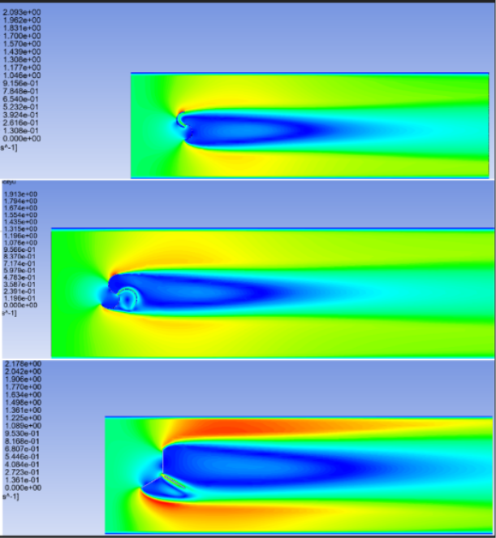
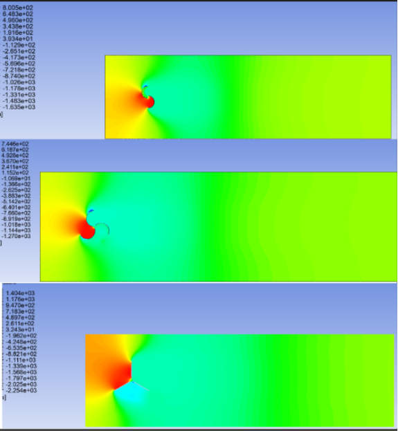
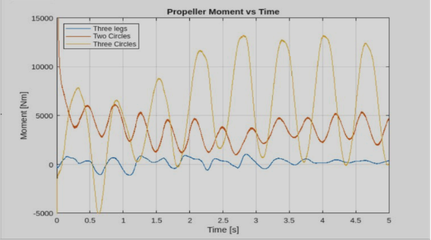

## Overview

One paragraph: what it is, who it is for, and what changed as a result.

## Problem

What was missing or broken, and why it mattered.

## Approach

As can be seen by the comparisons, the large (.12m outer, .03m inner) mesh is a bit more inaccurate. However, both the small and medium meshes converge to the same values. Thus, the medium mesh was chosen to balance calculation velocity and accuracy. 

**Streamlines and Property Contours**



<iframe width="560" height="315" src="https://www.youtube.com/embed/hPV67A5Kxuw?controls=0&rel=0" title="YouTube video player" frameborder="0" allow="accelerometer; autoplay; clipboard-write; encrypted-media; gyroscope; picture-in-picture; web-share" allowfullscreen></iframe>





<iframe width="560" height="315" src="https://www.youtube.com/embed/aUdA4n3NQAI?controls=0&rel=0" title="YouTube video player" frameborder="0" allow="accelerometer; autoplay; clipboard-write; encrypted-media; gyroscope; picture-in-picture; web-share" allowfullscreen></iframe>





<iframe width="560" height="315" src="https://www.youtube.com/embed/1yQJVNzegyk?controls=0&rel=0" title="YouTube video player" frameborder="0" allow="accelerometer; autoplay; clipboard-write; encrypted-media; gyroscope; picture-in-picture; web-share" allowfullscreen></iframe>



## Results

From the results we can compare the respective power generated by each of the propellers. Surprisingly, using three half circles vs two half circles results in a doubling of power generated instead of a 50% increase as one might initially assume. Also surprising was the incredibly low efficiency of the three leg propeller. It seems that a curved shape is significantly better at capturing the speed of the flow than a straight leg.
