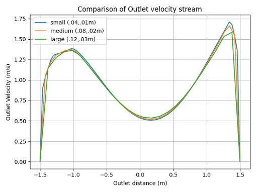

## Overview

One paragraph: what it is, who it is for, and what changed as a result.

## Problem

What was missing or broken, and why it mattered.

## Approach

As can be seen by the comparisons, the large (.12m outer, .03m inner) mesh is a bit more inaccurate. However, both the small and medium meshes converge to the same values. Thus, the medium mesh was chosen to balance calculation velocity and accuracy. 



<iframe width="560" height="315" src="https://www.youtube.com/embed/hPV67A5Kxuw?controls=0&rel=0" title="YouTube video player" frameborder="0" allow="accelerometer; autoplay; clipboard-write; encrypted-media; gyroscope; picture-in-picture; web-share" allowfullscreen></iframe>





<iframe width="560" height="315" src="https://www.youtube.com/embed/aUdA4n3NQAI?controls=0&rel=0" title="YouTube video player" frameborder="0" allow="accelerometer; autoplay; clipboard-write; encrypted-media; gyroscope; picture-in-picture; web-share" allowfullscreen></iframe>





<iframe width="560" height="315" src="https://www.youtube.com/embed/1yQJVNzegyk?controls=0&rel=0" title="YouTube video player" frameborder="0" allow="accelerometer; autoplay; clipboard-write; encrypted-media; gyroscope; picture-in-picture; web-share" allowfullscreen></iframe>



## Stack

- Language / framework:
- Data / infrastructure:
- Tooling:

## Results

Measurable outcome — latency, accuracy, users, hours saved — plus a link to the
repository or demo.

## Links

- Repository:
- Demo:

## Notes

What you would do differently next time.
