## Overview

ANSYS Fluent labs completed for ME 5620 Computational Fluid Dynamics. Each lab sets up a flow problem, verifies grid independence, and checks the CFD result against an analytical or hand-calculated solution. The progression runs from external laminar flow, through internal flow and heat transfer, to transient, conjugate, compressible, and turbulent problems.

## Key Results

| Lab | Problem | Result |
|---|---|---|
| 1 | Laminar flat-plate boundary layer | Re = 65,859 at plate end; CFD velocity profile matches the Blasius solution |
| 2 | Heated laminar pipe flow | Exit temperature 373 K (CFD) vs 388 K (analytical), within 5%; identical on 4 grids |
| 3 | T-junction thermal mixing | Mean exit temperature within 1% of energy balance; CFD reveals non-uniform exit profile |
| 4 | Flow past a cylinder | Transient vortex shedding captured in the wake |
| 6 | Thermal energy storage cycle | SM2 stores 2.07 MJ vs 0.955 MJ for SM1 over a charge cycle |
| 7 | Tube bank crossflow | Converged above 2×10⁻⁴ m mesh; q″ ≈ 42 kW/m², q ≈ 1.32 kW per tube |
| 8 | Airfoil at Mach 0.4–1.3 | Incompressible model underpredicts drag at Mach 1.3 by ~2.5× |
| 9 | Turbulent pipe flow, 4 models | SA, k-ε, k-ω within 5% on velocity; laminar model fails at Re = 5000 |

## Labs

### Lab 1: Laminar Flow Over a Flat Plate

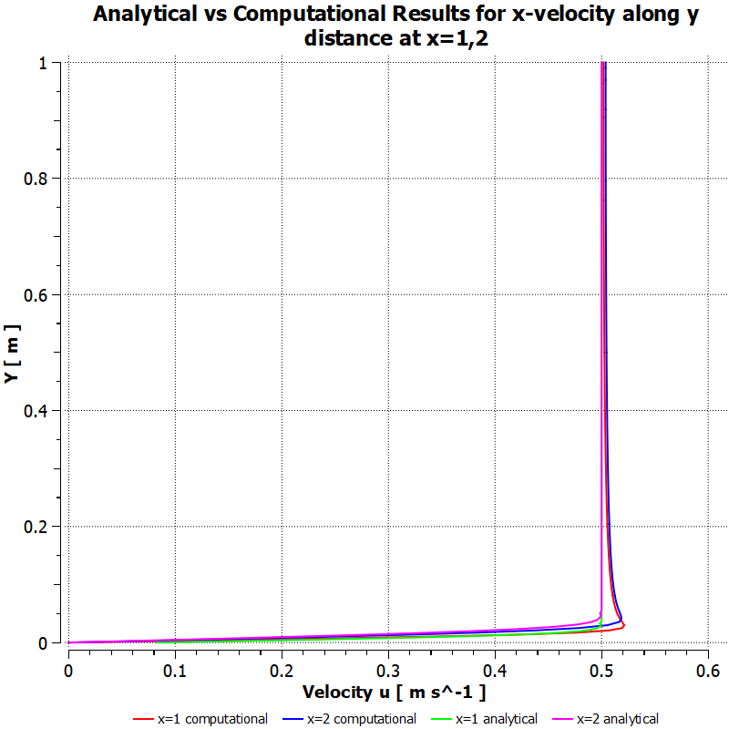

Computed x-velocity profiles at x = 1 m and x = 2 m overlaid on the Blasius solution. With Re = 65,859 at the trailing edge the flow stays laminar, and the boundary layer grows from 2.8 cm to 3.9 cm.

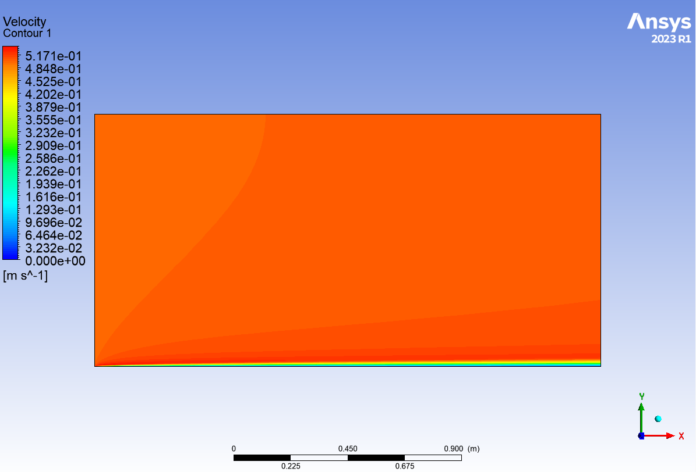

Velocity magnitude contour showing boundary-layer growth along the plate.

### Lab 2: Heat Transfer in a Laminar Pipe Flow

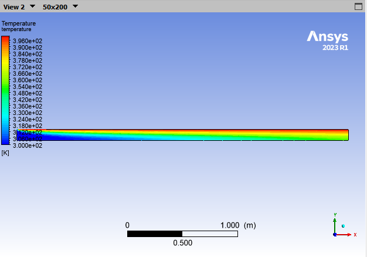

Temperature field as the heated wall warms the developing flow.

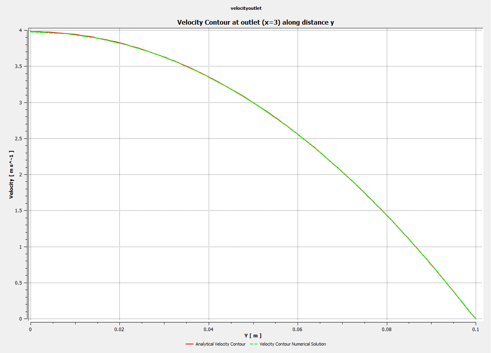

Exit velocity profile: the CFD result lies on the analytical parabolic profile.

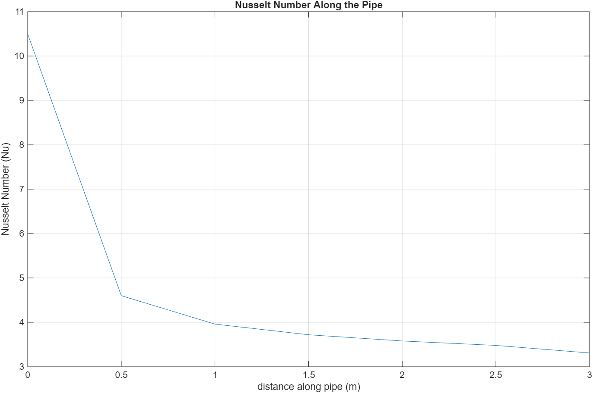

Nusselt number decays through the entrance region and levels off once the flow is thermally fully developed. Exit temperature is 373 K from CFD vs 388 K analytically (<5%), and the result is unchanged across four grids.

### Lab 3: Mixing in a T-Junction

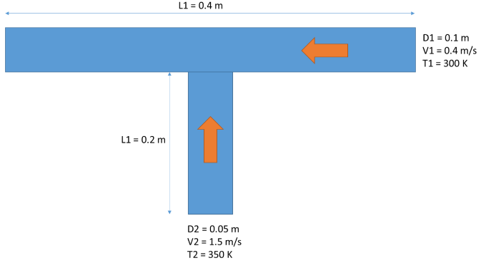

A 300 K main flow (D₁ = 0.1 m, 0.4 m/s) mixes with a 350 K branch flow (D₂ = 0.05 m, 1.5 m/s).

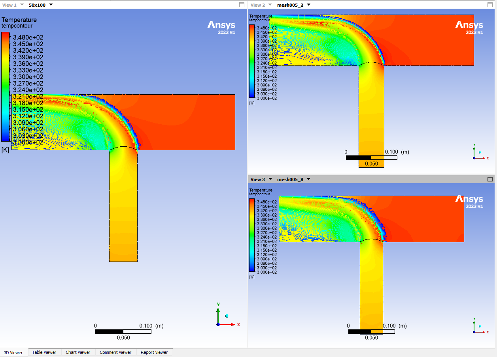

Neither branch is fully developed before the streams meet. The mean exit temperature agrees with the energy balance to within 1%.

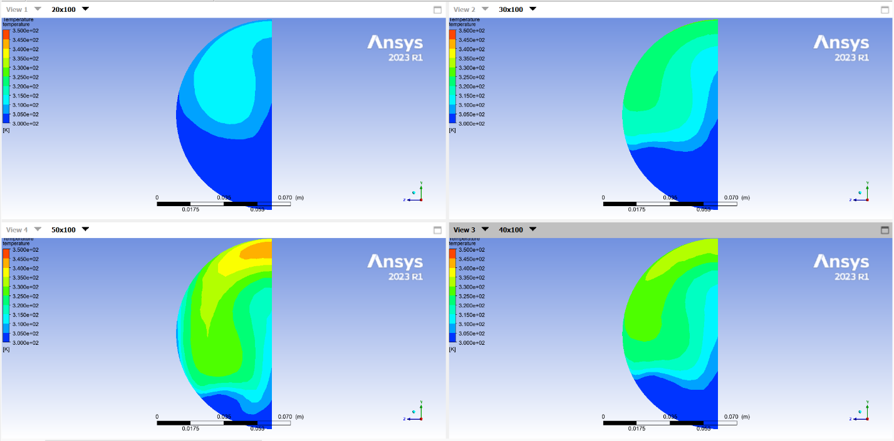

Exit-plane temperature for D₂ = 0.02–0.05 m. The distribution keeps its shape while the mean rises from 306 K to 322 K, detail a lumped energy balance cannot capture.

### Lab 4: Flow Past a Cylinder

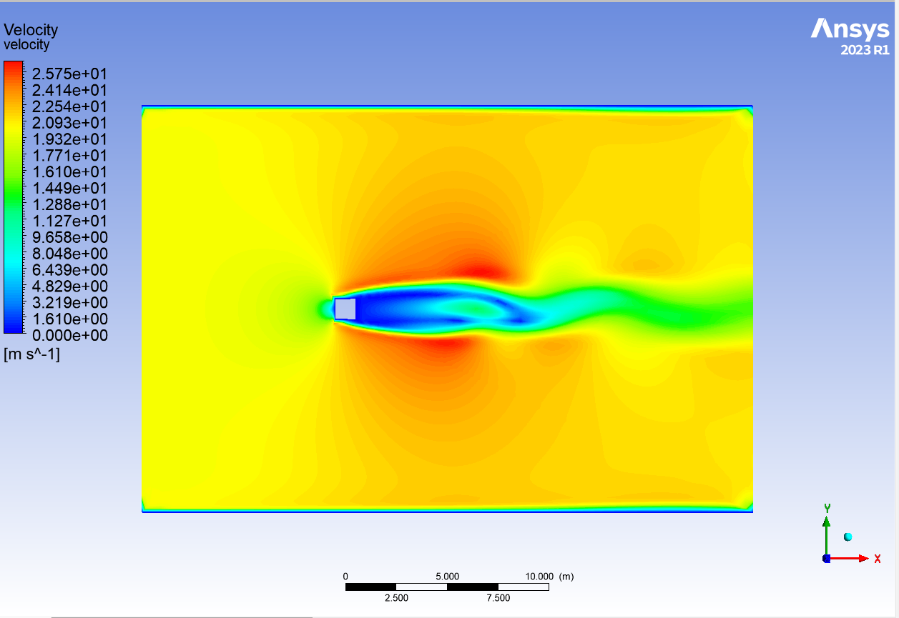

Transient velocity field with an oscillating wake behind the cylinder.

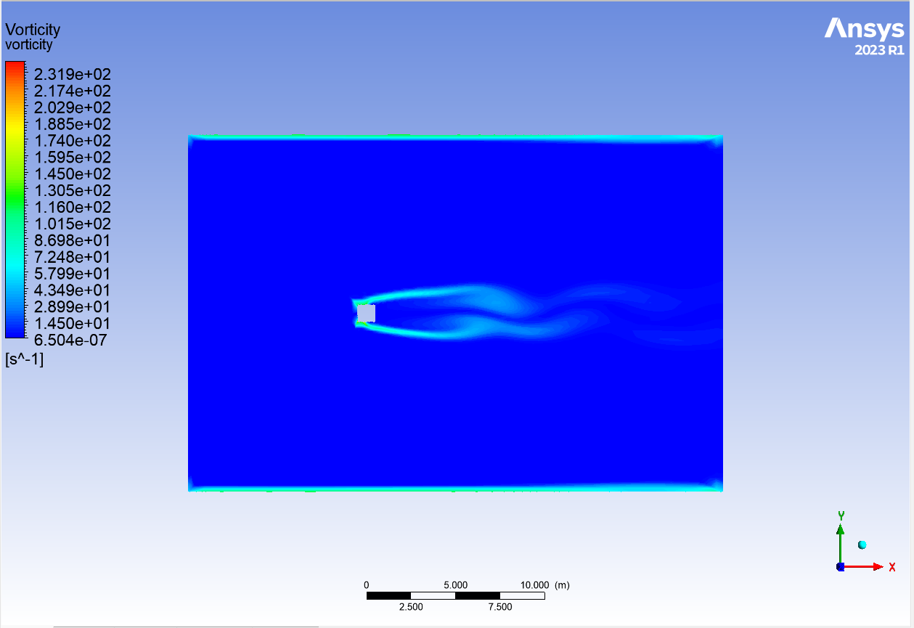

Vorticity shed alternately from the top and bottom of the cylinder.

<!-- VIDEO: Lab 4 vorticity / streamline / velocity animations -->

### Lab 6: Conjugate Heat Transfer in Thermal Energy Storage

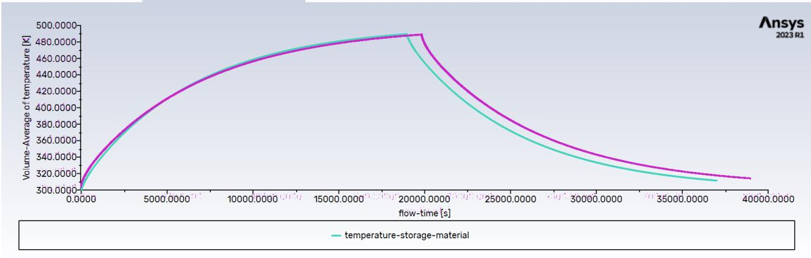

Volume-averaged storage-material temperature over a full charge/discharge cycle for SM1 (turquoise) and SM2 (magenta).

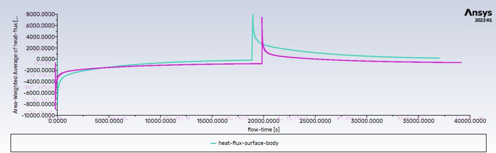

Heat flux between the heat-transfer fluid and the storage material, reversing sign at the switch from charge to discharge. Heated from 300 K to 490 K, SM2 (ρ = 1300 kg/m³, cₚ = 1200 J/kg·K) stores 2.07 MJ against 0.955 MJ for SM1.

<!-- VIDEO: Lab 6 temperature field over a charge/discharge cycle -->

### Lab 7: Laminar Crossflow Over a Tube Bank

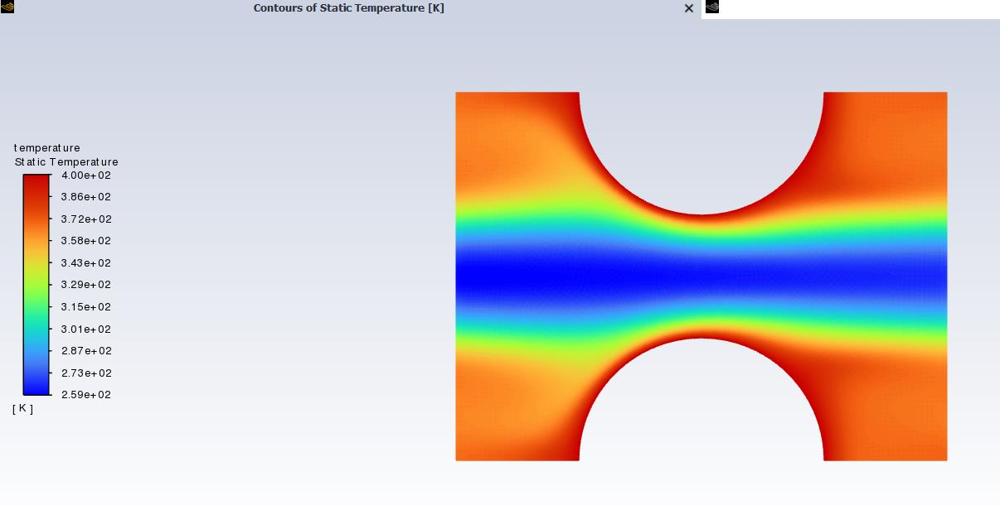

Temperature field between 400 K tubes in a 300 K crossflow (D = 1 cm, S_T = S_L = 1.5 cm).

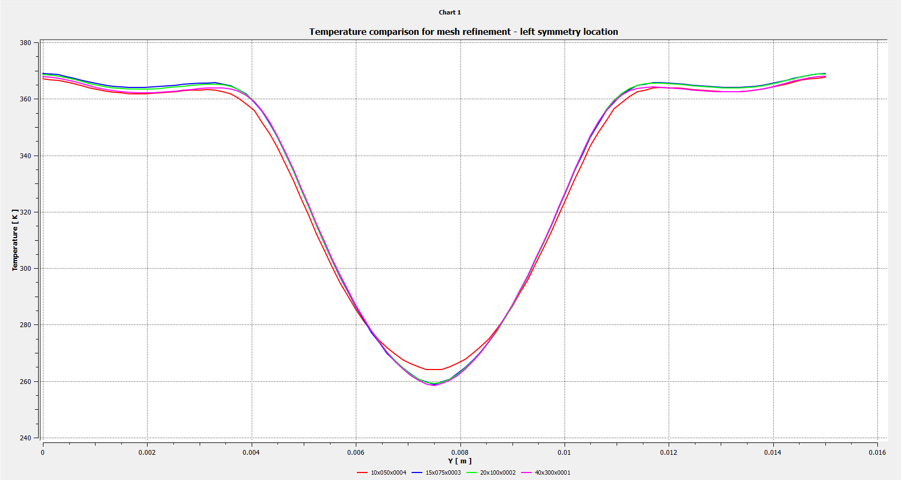

Temperature along the inlet symmetry line for four mesh sizes; the solution converges once the global size reaches 2×10⁻⁴ m. Downstream, the average wall heat flux is about 42 kW/m², or 1.32 kW per tube per metre of depth.

### Lab 8: Compressible Flow Over an Airfoil

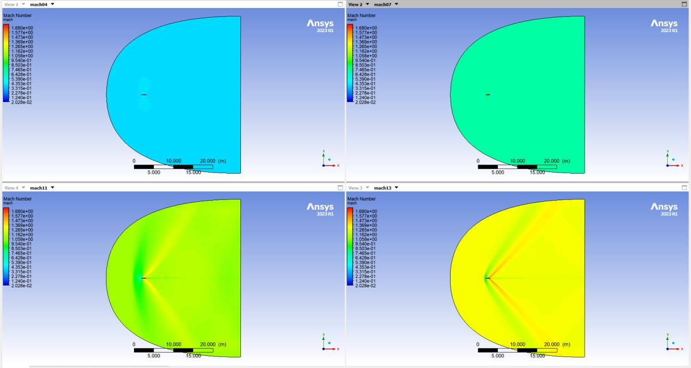

Mach number fields at Mach 0.4, 0.7 (top) and 1.1, 1.3 (bottom); shocks form at supersonic speeds.

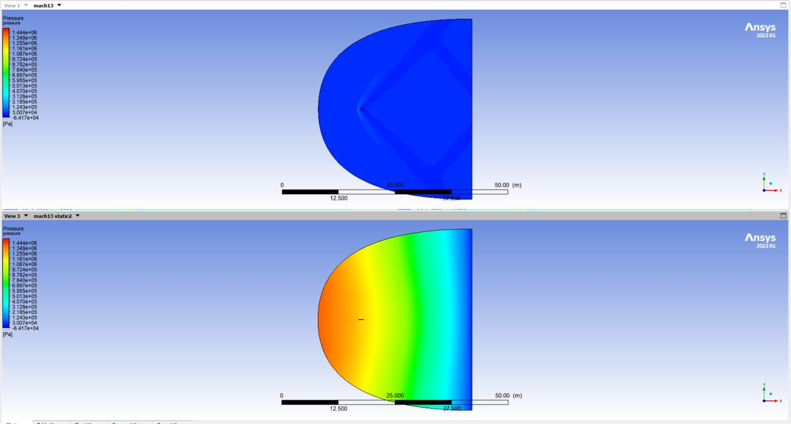

Pressure at Mach 1.3, compressible (top) vs incompressible (bottom). The incompressible solution misses the shock entirely.

| Case | Lift Force | Drag Force |
|---|---|---|
| Mach 0.4 | 10.57 | 126.93 |
| Mach 0.7 | −261.05 | 384.92 |
| Mach 1.1 | −85.89 | 12,512.67 |
| Mach 1.3, compressible | −113.98 | 16,931.88 |
| Mach 1.3, incompressible | 171.49 | 6,662.69 |

Above roughly Mach 0.5 the section produces net downforce and drag rises steeply, and the incompressible assumption gives the wrong sign of lift.

### Lab 9: Turbulence Models in Pipe Flow

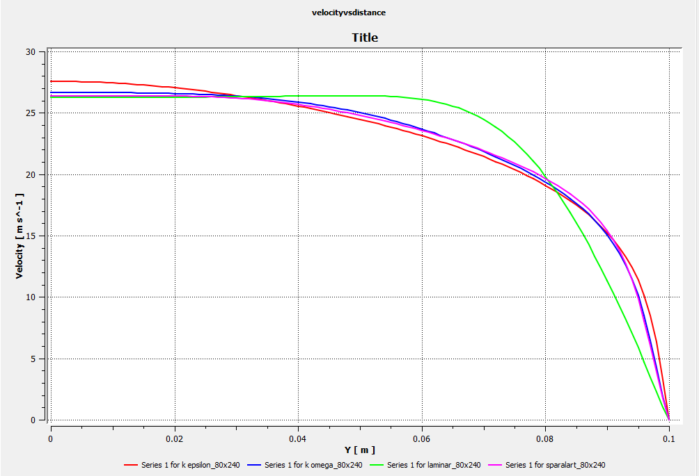

Axial velocity across the pipe at Re = 5000 for laminar, Spalart–Allmaras, k-ε, and k-ω models. The three turbulence models agree within 5%; the laminar model does not capture the flatter turbulent profile.

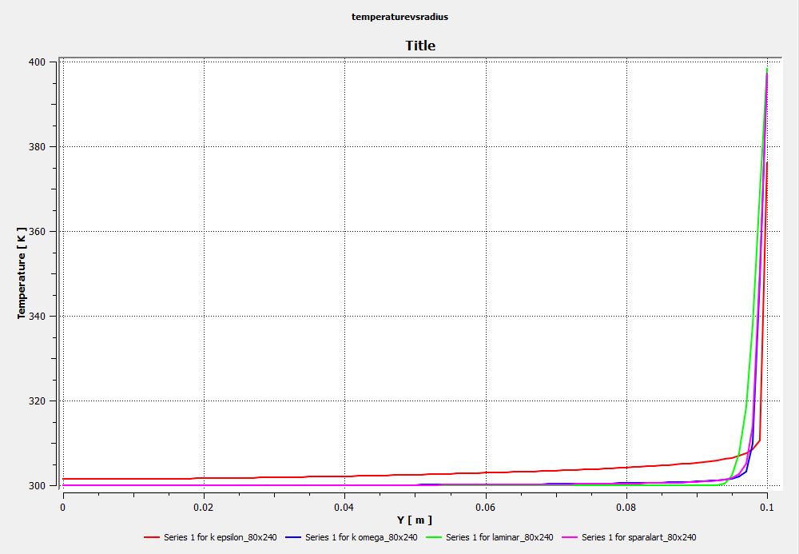

Temperature near the 400 K wall: SA, k-ω, and laminar agree closely, with k-ε within 10%.

## Summary

These eight labs cover the core ANSYS Fluent workflow, ordered by increasing complexity. They begin with laminar external flow over a flat plate, move to internal flow and heat transfer in pipes and a T-junction, then to transient vortex shedding and conjugate heat transfer in a thermal-storage element. The later labs cover a tube bank, compressible flow up to Mach 1.3, and a comparison of turbulence models. Each lab includes a grid-refinement study and a comparison against analytical or hand-calculated results, so the CFD numbers are verified rather than taken at face value.
