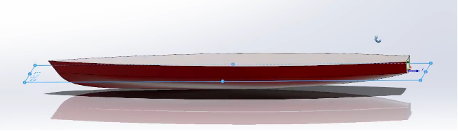
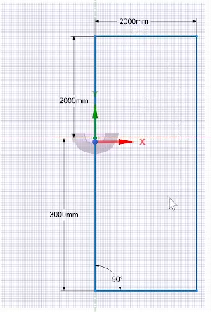
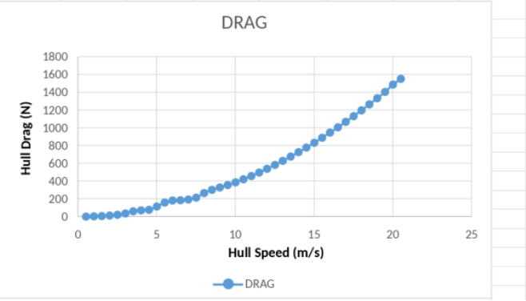

## Overview

CFD analysis of Carnegie Mellon Solar Racing boat hull at expected competition speeds. 

## Problem

As part of a larger project to optimize energy management in the system and coordinate solar panel input energy, with electric motor and drag force, we needed drag values for the hull in order to inform our decisions. As part of the propulsion sub-team I was in charge of doing the CFD simulation using ANSYS Fluent. 

## Process

The initial CAD design outlines the following hull dimensions:
- Length: 18 feet 
- Width: 3–4 feet 
- Height: 3 feet 

Import Solidwords CAD Model to ANSYS Discover for preprocessing. 

Prepare the fluid domain 

The mesh was then refined around the hull to ensure simulation accuracy. 

## Results

Hull drag force (N) increase exponentially with an equation of best fit of $e^{.4484x}$

