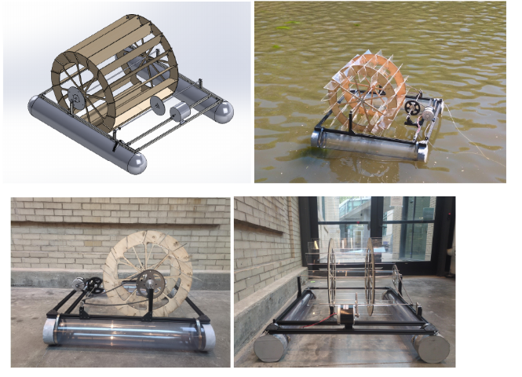
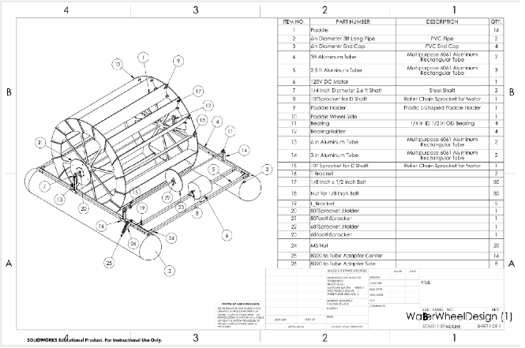
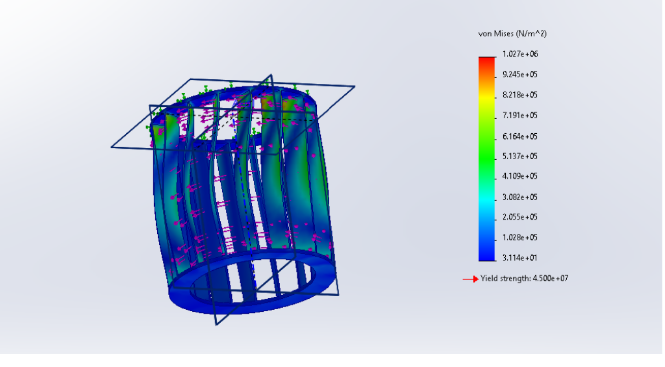
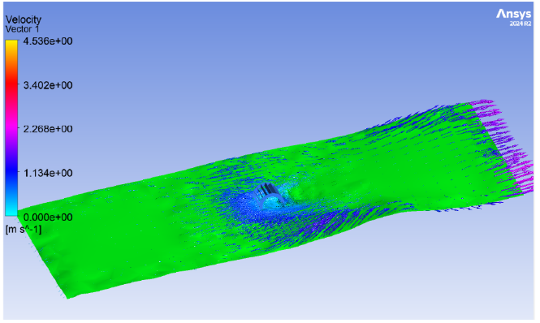

## Overview

This project is a portable, floating micro-hydro generator: a water wheel driven by a stream's current turns a DC motor through a roller-chain drive to produce electricity, all mounted on a lightweight aluminum pontoon frame. The goal was a low-cost, transportable power source deployable in a natural water body without any civil works.

## Problem

Conventional micro-hydro hardware is heavy, site-specific, and costly to prototype. For a demonstration-scale generator there was no lightweight, portable way to extract energy from an existing current. The design had to float, survive the repeated loads of flowing water, and convert the wheel's rotation into usable electricity using off-the-shelf parts.

## Approach

The architecture is a vertical-axis paddle wheel mounted ahead of two PVC pontoon floats. Current pushes the paddles, the rotation is stepped up by a sprocket-and-chain drive, and that turns a 120V DC motor running as a generator. A 6061 aluminum tube frame carries the loads while the PVC pipe and end caps supply buoyancy.

The key decision was a vertical-axis paddle wheel rather than an enclosed turbine: it is far simpler to fabricate, tolerates debris and variable flow, and needs no penstock — acceptable trade-offs for a portable demonstrator. A commodity DC motor was chosen as the generator to keep cost and characterization low.

CAD model (top left) alongside the built prototype on water and two frame iterations.

**Bill of Materials**

| PART | DESCRIPTION | MATERIAL / SPEC | QTY |
| --- | --- | --- | --- |
| Paddle | L-shaped paddle | Plastic | 16 |
| Pontoon | 6 in pipe, 3 ft | PVC | 2 |
| End caps | 6 in | PVC | 4 |
| Frame tube | Structural tube | 6061 aluminum | 15 |
| Drive shaft | 2.6 ft shaft | 1/4 in steel | 2 |
| Generator | Motor | 120V DC | 1 |
| Bearing | Shaft bearing | 1/4 in ID x 1/2 in OD | 4 |
| Drive | Sprockets + chain | 80T / 60T / 10T | set |
| Hardware | Adapters, nuts, bolts | — | assorted |

## Results

A static structural analysis of the wheel-frame assembly confirmed the design is over-built for the expected loads: peak von Mises stress reached 1.03 MPa against a 45 MPa yield strength for 6061 aluminum, a factor of safety near 44. Stress concentrates at the top wheel mounts — the natural high-load point — so those joints are the place to reinforce on the next iteration.

A flow simulation showed the current accelerating around the hull, reaching roughly 4.5 m/s, with the flow channeled through the wheel zone. This confirms the pontoon geometry directs water toward the paddles rather than around them.

